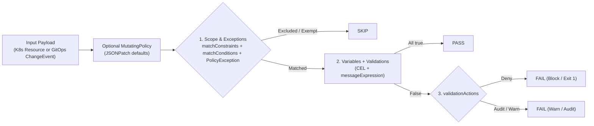

# Kyverno From First Principles: CEL Policies for Kubernetes & GitOps (Go, `v1.20.0`)

A hands-on engineering exploration of **Kyverno `v1.20.0`** in a single unified Go module:
- **Kubernetes admission & mutation (`cmd/k8s`)** using `ValidatingPolicy`, `MutatingPolicy`, `PolicyException` (`policies.kyverno.io/v1`), Pod-controller **Autogen**, `parseImageReference()`, `oldObject` `UPDATE` diffs, and built-in `--explain`-style decision traces (`trace.Render`).
- **Non-Kubernetes GitOps state-transition guardrails (`cmd/gitops`)** using `evaluation.mode: JSON` (which superseded the archived `kyverno-json` sub-project) across both **JSON and YAML** infrastructure resources, multi-file `-git-base` PR scans, `Deny` vs `Warn` policies, JSON-mode `MutatingPolicy`, and a **compile-once from-first-principles CEL engine** (`internal/firstprinciples`) running with 100% parity alongside Kyverno's official engine.

---

## Mental Model: What Is Kyverno Really?

At its core, Kyverno is **not magic**—it is a **declarative scope-matching, mutation, and CEL evaluation engine** wrapped in a Kubernetes admission controller (and a standalone JSON evaluator).

Every `ValidatingPolicy` (`policies.kyverno.io/v1`) boils down to three stages:

1. **Scope (`matchConstraints` / `matchConditions` / `PolicyException`)**: *Does this policy apply, and is an active non-expired exception granting an exemption (with compensating `validations` satisfied)?* In Kubernetes mode, `matchConstraints` filters API group/version/resource/operation; in `evaluation.mode: JSON`, `matchConstraints` is bypassed and `matchConditions` filters arbitrary JSON/YAML payloads.
2. **Compute (`variables` + `validations` in CEL)**: *Compile expressions once and evaluate `object`, `oldObject`, and lazy `variables`.* Expressions safely traverse optional paths (`.?` / `.orValue(...)`), parse container references (`parseImageReference`), filter lists (`.filter(...)` / `.map(...)`), and format actionable errors with `messageExpression`.
3. **Decide (`Deny`, `Audit`, or `Warn`)**: Only `Deny` blocks admission or CI (`exit 1`); `Audit` and `Warn` surface non-blocking findings.



---

## Repository Layout

```text
kyverno-show/
├── go.mod / go.sum                              # Single Go module (Kyverno v1.20.0 + google/cel-go)
├── LICENSE
├── README.md
├── internal/
│   ├── kit/
│   │   └── kit.go                               # Multi-doc YAML/JSON loader, vpol+mpol+PolicyException runner & -explain traces
│   ├── firstprinciples/
│   │   ├── engine.go                            # Compile-once mini CEL engine (variables, messageExpression, actions, trace)
│   │   └── engine_test.go
│   └── jsondiff/
│       ├── diff.go                              # Recursive RFC 6902 diff over JSON & YAML -> ChangeEvent
│       └── diff_test.go
├── cmd/
│   ├── k8s/                                     # Kubernetes Mutate -> Validate CLI + tests
│   └── gitops/                                  # Structured JSON/YAML GitOps CLI (-engine kyverno | mini) + parity tests
├── k8s/
│   ├── policies/
│   │   ├── pod-security.yaml                    # Pod-targeted policies (Autogen -> Deployment/CronJob/etc.)
│   │   ├── governance.yaml                      # Audit labels + UPDATE oldObject scale-to-zero guard
│   │   └── mutate-pod-defaults.yaml             # MutatingPolicy (JSONPatch) injecting non-root & label defaults
│   ├── exceptions/
│   │   └── legacy-waiver.yaml                   # Time-bound PolicyException with compensating controls
│   └── manifests/                               # Bad/good Deployments, CronJob, scale-zero, waiver valid & refused
└── gitops/
    ├── policies/
    │   ├── postgres-policy.yaml                 # Create, allowlist, no shrink (Deny), >2x growth (Warn)
    │   ├── kafka-policy.yaml                    # Allowlist, partition floor, replication >= 3, acls[]
    │   ├── aws-secret-policy.yaml               # No plaintext secret, rotation bounds, immutable kmsKeyId
    │   └── mutate-postgres-defaults.yaml        # JSON-mode MutatingPolicy auto-setting encryptionEnabled & window
    ├── exceptions/
    │   └── incident-waiver.yaml                 # JSON-mode PolicyException requiring INC-#### ticket
    └── samples/                                 # JSON & YAML resource states + 1 reference ChangeEvent JSON
```

---

## Part 1: Kubernetes CEL Policies (`cmd/k8s`)

Part 1 embeds Kyverno `v1.20.0`'s official `vpol` and `mpol` CEL engines directly in Go—no cluster needed—while keeping every YAML file ready for `kyverno apply` or a live `k3s` cluster.

### 1.1 Modern Kyverno `v1.20` Features Demonstrated

1. **Pod-Controller Autogen ([pod-security.yaml](./k8s/policies/pod-security.yaml))**:
   Both `disallow-mutable-image` and `require-non-root` match `pods` once. `vpolengine.NewProvider` automatically generates rules for `Deployments`, `StatefulSets`, `DaemonSets`, `Jobs`, and `CronJobs`—catching both [deployment-bad.yaml](./k8s/manifests/deployment-bad.yaml) and [cronjob-bad.yaml](./k8s/manifests/cronjob-bad.yaml) without duplicating policies.
2. **Built-in `parseImageReference()` + `variables` + `messageExpression`**:
   Instead of naive string checks (`image.contains(':')`, which falsely passes `localhost:5000/migrator`), `disallow-mutable-image` checks `!parseImageReference(c.image).containsDigest()` and `.tag()` across `containers`, `initContainers`, and `ephemeralContainers`, printing exact offenders (`web=nginx:latest, migrator=localhost:5000/migrator`).
3. **`UPDATE` (`oldObject` vs `object`) ([governance.yaml](./k8s/policies/governance.yaml))**:
   `forbid-prod-scale-to-zero` matches `UPDATE` on `deployments` in `production` and compares `oldObject.spec.?replicas` against `object.spec.?replicas`.
4. **`MutatingPolicy` ([mutate-pod-defaults.yaml](./k8s/policies/mutate-pod-defaults.yaml))**:
   Uses `JSONPatch` with `lists.range(...)` to inject `managed-by: kyverno`, `runAsNonRoot: true`, and `allowPrivilegeEscalation: false` across all containers before validation runs (`-mutate`).
5. **`PolicyException` with `expiresAt` & Compensating Controls ([legacy-waiver.yaml](./k8s/exceptions/legacy-waiver.yaml))**:
   Exempts `legacy-payments` from `require-non-root` *only* before `expiresAt` and *only* if `security.acme.io/waiver: SEC-####` and `readOnlyRootFilesystem: true` are present. Missing the compensating control triggers Kyverno's `RefusedException` failure with the waiver's explanation.
6. **Decision Tracing (`-explain`)**:
   Uses `vpolcompiler.NewCompilerWithTrace(true)` + `trace.Render` to inspect scope matching, lazy variables, and AST sub-expressions.

### 1.2 Running Part 1 Locally

```bash
# Run all Kubernetes policy tests
go test -v ./cmd/k8s/...

# 1. Bad Deployment: 2 Deny failures + 1 Audit failure + AST decision trace
go run ./cmd/k8s -manifest ./k8s/manifests/deployment-bad.yaml -explain

# 2. Mutate -> Validate pipeline: MutatingPolicy fixes require-non-root to PASS
go run ./cmd/k8s -manifest ./k8s/manifests/deployment-bad.yaml -mutate

# 3. Pod-controller Autogen catches a CronJob automatically
go run ./cmd/k8s -manifest ./k8s/manifests/cronjob-bad.yaml

# 4. Time-bound PolicyException (valid vs refused compensating control)
go run ./cmd/k8s -manifest ./k8s/manifests/deployment-waiver-valid.yaml -exception ./k8s/exceptions/legacy-waiver.yaml
go run ./cmd/k8s -manifest ./k8s/manifests/deployment-waiver-refused.yaml -exception ./k8s/exceptions/legacy-waiver.yaml

# 5. Simulate UPDATE (oldObject -> object) blocking scale-to-zero in production
go run ./cmd/k8s -old-manifest ./k8s/manifests/deployment-good.yaml -manifest ./k8s/manifests/deployment-scale-zero.yaml
```

Observed output on `deployment-bad.yaml` with `-explain` (trace excerpt):

```text
[FAIL] policy=require-standard-labels action=Audit target=Deployment/production/payments-api rule=validation
       message: Deployment missing required ownership label(s): team, env
[FAIL] policy=disallow-mutable-image action=Deny target=Deployment/production/payments-api rule=validation
       message: Container image(s) must use an immutable tag or digest: web=nginx:latest, migrator=localhost:5000/migrator
[FAIL] policy=require-non-root action=Deny target=Deployment/production/payments-api rule=validation
       message: Pod must set securityContext.runAsNonRoot=true and disallow allowPrivilegeEscalation (offending: web, migrator)

=== Decision Traces ===
Policy:   require-standard-labels (ValidatingPolicy)
Resource: Deployment/payments-api (namespace: production)

SCOPE      applied  matched kind Deployment, namespace production, operation CREATE
VARIABLES           missing: ['team', 'env'].filter(k, object.metadata.?labels[?k].orValue('') == '')  ->  [team env]
VERDICT    FAIL     size(variables.missing) == 0  ->  false
                    message: "Deployment missing required ownership label(s): team, env"
...
Summary: 3 evaluations, 2 enforced failures
```

### 1.3 Running the Exact Same Policies with `kyverno` CLI or `k3s` (WSL)

```bash
kyverno apply ./k8s/policies --resource ./k8s/manifests/deployment-bad.yaml
```

Or in a live `k3s` cluster under WSL:

```bash
curl -sfL https://get.k3s.io | sh -
mkdir -p ~/.kube && sudo cp /etc/rancher/k3s/k3s.yaml ~/.kube/config && sudo chown $USER ~/.kube/config

helm repo add kyverno https://kyverno.github.io/kyverno/ && helm repo update
helm install kyverno kyverno/kyverno -n kyverno --create-namespace --wait

kubectl apply -f k8s/policies/
kubectl create namespace production
kubectl apply -f k8s/manifests/deployment-bad.yaml   # Blocked by admission webhook
kubectl apply -f k8s/manifests/deployment-good.yaml  # Allowed
```

---

## Part 2: Structured GitOps Validation & First-Principles Engine (`cmd/gitops`)

When GitOps repositories manage structured infrastructure definitions (`PostgresDatabase`, `KafkaTopic`, `AwsSecretsManagerSecret`) in JSON or YAML, running regexes on raw diff lines breaks down. [internal/jsondiff/diff.go](./internal/jsondiff/diff.go) parses **both JSON and YAML** into a typed `ChangeEvent` (`operation`, `before`, `after`, RFC 6902 `diff.changes[]`), and evaluates the exact same `policies.kyverno.io/v1` YAML policies (`evaluation.mode: JSON`) across two engines:

| Engine | Implementation | Capabilities | Best For |
| :--- | :--- | :--- | :--- |
| **`-engine kyverno`** (default) | Official Kyverno `v1.20.0` `vpol` + `mpol` CEL engines | Full `ValidatingPolicy`, JSON-mode `MutatingPolicy`, `PolicyException`, AST `-explain` | Production CI/CD pipelines |
| **`-engine mini`** | Compile-once evaluator ([internal/firstprinciples/engine.go](./internal/firstprinciples/engine.go)) over `google/cel-go` | `Compile()` once -> `Evaluate()`, `matchConditions`, `variables`, `messageExpression`, `Deny`/`Warn`, `-explain` trace | Understanding how CEL policy engines work inside |

### 2.1 Policy Highlights (`gitops/policies/`)

- **Zero-regex transition guardrails** using `.?` optional chaining, `spec.variables`, and `messageExpression`:
  - `postgres-update-allowed-attributes` pinpoints immutable paths changed (`modified immutable attribute(s): /spec/region`).
  - `postgres-no-disk-shrink` compares `beforeGB` vs `afterGB` (`200 -> 100`, or `200 -> missing` if deleted).
  - `postgres-large-disk-jump` uses `validationActions: [Warn]` to warn on `> 2x` disk expansion without failing CI (`exit 0`).
  - `kafka-prod-acl-guardrails` iterates `spec.acls[]` and reports the exact offending principal/operation (`User:*:ALL`).
- **JSON-mode `MutatingPolicy`** ([mutate-postgres-defaults.yaml](./gitops/policies/mutate-postgres-defaults.yaml)): auto-enables `encryptionEnabled: true` and populates `maintenanceWindow` before diffing/validating.
- **Break-glass `PolicyException`** ([incident-waiver.yaml](./gitops/exceptions/incident-waiver.yaml)): waives `postgres-update-allowed-attributes` only when `-ticket INC-####` satisfies the compensating control.

### 2.2 Running Part 2 Locally

```bash
# Run unit & cross-engine parity tests across the entire workspace
go test -v ./...

# 1. Illegal Postgres update (official Kyverno engine)
go run ./cmd/gitops -before ./gitops/samples/postgres-update-before.json -after ./gitops/samples/postgres-update-bad.json -engine kyverno

# 2. Same payload with the compile-once first-principles engine + step-by-step trace
go run ./cmd/gitops -before ./gitops/samples/postgres-update-before.json -after ./gitops/samples/postgres-update-bad.json -engine mini -explain

# 3. Non-blocking Warn policy (>2x disk growth: 200 -> 600 GB, exits 0)
go run ./cmd/gitops -before ./gitops/samples/postgres-update-before.json -after ./gitops/samples/postgres-update-warn.json

# 4. YAML support + JSON-mode MutatingPolicy auto-remediation
go run ./cmd/gitops -after ./gitops/samples/postgres-create-bad.yaml
go run ./cmd/gitops -after ./gitops/samples/postgres-create-bad.yaml -mutate

# 5. Break-glass PolicyException granted by incident ticket INC-9911
go run ./cmd/gitops -before ./gitops/samples/postgres-update-before.json -after ./gitops/samples/postgres-update-bad.json -exception ./gitops/exceptions/incident-waiver.yaml -ticket INC-9911

# 6. Multi-file PR scan against a base git ref (discovers all modified JSON/YAML files)
go run ./cmd/gitops -git-base origin/main

# 7. Evaluate a pre-built ChangeEvent JSON directly with the official kyverno CLI
kyverno apply ./gitops/policies --json ./gitops/samples/postgres-update-bad.event.json
```

Observed output from `-engine mini -explain` on `postgres-update-bad.json`:

```text
Operation=update | Kind=PostgresDatabase | Env=prod | Changes=3
  [replace] /spec/backupRetentionDays: 14 -> 3
  [replace] /spec/region: eu-central-1 -> us-east-1
  [replace] /spec/storageGB: 200 -> 100
[FAIL] policy=postgres-update-allowed-attributes action=Deny target=orders-db rule=validation
       message: PostgresDatabase update modified immutable attribute(s): /spec/region
       trace: [MATCH] is-postgres-update (object.operation == 'update' && object.kind == 'PostgresDatabase') -> true
       trace: [VAR] forbidden = [/spec/region]
       trace: [CEL] validation[0] (size(variables.forbidden) == 0) -> false
       trace: [FAIL] PostgresDatabase update modified immutable attribute(s): /spec/region
[FAIL] policy=postgres-no-disk-shrink action=Deny target=orders-db rule=validation
       message: PostgresDatabase storageGB cannot shrink or be removed: 200 -> 100
...
[FAIL] policy=postgres-prod-backup-floor action=Deny target=orders-db rule=validation
       message: Production PostgresDatabase backupRetentionDays is 3; must be >= 7
...
[PASS] policy=postgres-large-disk-jump action=Warn target=orders-db rule=validation
...

Summary: EnforcedFailures=3 | Warnings=0
```

---

## Key Takeaways

1. **One policy model (`policies.kyverno.io/v1`) across K8s & GitOps**: `ValidatingPolicy`, `MutatingPolicy`, and `PolicyException` share the same CEL compiler, optional chaining, and trace engine across Kubernetes webhooks and `evaluation.mode: JSON`.
2. **Autogen + built-in CEL libs keep policies concise**: Writing Pod-level security rules once with `parseImageReference()` and `variables` + `messageExpression` covers every workload controller while returning pinpoint errors.
3. **Compile once, evaluate everywhere**: Stripped of webhook plumbing, a CEL policy engine compiles expressions into programs at load time (`Compile`) and evaluates activations (`object`, `variables`) in microseconds (`Evaluate`).
