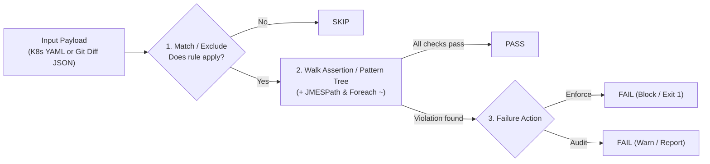

# Kyverno From First Principles: Kubernetes Admission Policies & Custom GitOps Diff Validation in Go

A hands-on engineering exploration of **Kyverno**—how its Go engine evaluates Kubernetes `ClusterPolicy` manifests, how a declarative `match` → `assert` engine works from first principles, and how `kyverno-json` enables zero-regex GitOps policy guardrails over structured JSON state transitions.

---

## Mental Model: What Is Kyverno Really?

At its core, Kyverno is **not magic**—it is a **declarative tree-matching & expression-evaluation engine** wrapped in a Kubernetes admission controller.

When you run `kubectl apply -f deployment.yaml`, the Kubernetes API server sends an `AdmissionReview` JSON payload (containing the object being created/updated) to Kyverno's webhook before persisting it to `etcd`. Inside Kyverno, every rule boils down to three steps:

1. **Scope (`match` / `exclude`)**: *Does this rule care about this payload?* (e.g., "Only check `Deployment` objects", or "Only check diffs touching `environments/prod/`"). If not, skip.
2. **Project & Evaluate (`pattern` / `assert` + JMESPath)**: *Walk the expected YAML tree side-by-side with the payload JSON tree.* Where keys are literal fields, descend into the object; where keys are expressions like `(regex_match(...))` or `~.files`, compute or iterate dynamically.
3. **Decide (`Enforce` vs `Audit`)**: Return `Pass`, `Fail`, or `Skip`. In Kubernetes, `Enforce` rejects the API request; `Audit` lets it through and records a `PolicyReport` violation.



---

## Repository Layout

```text
kyverno-show/
├── LICENSE                                    # MIT License
├── README.md
├── part1-k8s/                                 # Part 1: Classic Kubernetes ClusterPolicy in Go + k3s guide
│   ├── go.mod / go.sum
│   ├── main.go                                # Embeds github.com/kyverno/kyverno/pkg/engine
│   ├── main_test.go                           # Verifies bad vs good Deployment manifests
│   ├── policies/
│   │   ├── require-pod-security.yaml          # Enforce: no :latest tag, runAsNonRoot, no privilege escalation
│   │   └── require-standard-labels.yaml       # Audit: require metadata.labels.team and env
│   └── manifests/
│       ├── deployment-bad.yaml                # Triggers 2 Enforce failures + 1 Audit failure
│       └── deployment-good.yaml               # Passes all 3 rules
├── part2-gitops/                              # Part 2: First-principles GitOps diff validator in Go
│   ├── go.mod / go.sum
│   ├── main.go                                # CLI ('gitops-guard') supporting kyverno-json & mini engines
│   ├── main_test.go                           # Parity tests across both engines
│   ├── policies/
│   │   └── gitops-diff-policy.yaml            # ValidatingPolicy (json.kyverno.io/v1alpha1) for git diffs
│   ├── internal/
│   │   ├── diffparse/                         # Unified git diff -> structured DiffReport JSON adapter
│   │   └── firstprinciples/                   # ~230-line from-first-principles engine over Kyverno models
│   └── samples/
│       ├── *.diff                             # Raw unified git diff fixtures
│       └── parsed/*.diff.json                 # Exact DiffReport JSON payloads evaluated by the engine
└── part3-json-gitops/                         # Part 3: Production-style JSON State-Transition GitOps PoC
    ├── go.mod / go.sum
    ├── main.go                                # CLI comparing before/after JSON or git base vs working file
    ├── main_test.go                           # 13 tests covering Postgres, Kafka (+acls[]), AWS Secret & git
    ├── policies/
    │   ├── postgres-policy.yaml               # Create rules + update allowlist + no disk shrink
    │   ├── kafka-policy.yaml                  # Update allowlist + no partition shrink + replication + acls[]
    │   └── aws-secret-policy.yaml             # No plaintext secretString + rotation bounds + immutable kmsKeyId
    ├── internal/jsondiff/                     # Recursive RFC 6902-style JSON diff -> ChangeEvent
    └── samples/
        ├── *.json                             # Before/after JSON resource states
        └── events/*.event.json                # Pre-built ChangeEvent JSON payloads fed to kyverno-json
```

---

## Part 1: Classic Kubernetes Policy Validation (`part1-k8s`)

In Part 1, we use **real Kubernetes `ClusterPolicy` (`kyverno.io/v1`) manifests** and run them directly through Kyverno's own Go engine (`github.com/kyverno/kyverno/pkg/engine`)—no cluster required—while keeping the exact YAML files ready to apply to **k3s on WSL**.

### 1.1 Anatomy of the Policies

1. [require-pod-security.yaml](./part1-k8s/policies/require-pod-security.yaml) (`validationFailureAction: Enforce`):
   - **`disallow-latest-tag`**: Matches `Deployment` resources and asserts every container image matches the Kyverno wildcard pattern `"*:* & !*:latest"` (must contain a `:` tag, and must **not** end in `:latest`).
   - **`require-non-root`**: Asserts `spec.template.spec.securityContext.runAsNonRoot: true` and `allowPrivilegeEscalation: false` on every container.
2. [require-standard-labels.yaml](./part1-k8s/policies/require-standard-labels.yaml) (`validationFailureAction: Audit`):
   - **`check-team-and-env-labels`**: Asserts `metadata.labels.team` and `metadata.labels.env` match `"?*"` (at least 1 character, non-empty).

> **Note on `Pod` vs `Deployment` and Kyverno Autogen:**
> In a live cluster, if you write a rule matching `Pod`, Kyverno's background/autogen controller automatically generates sibling rules for `Deployment`, `StatefulSet`, `DaemonSet`, etc. Here, our policies match `Deployment` directly and inspect `spec.template.spec` so that the exact same YAML behaves identically in both standalone Go engine tests and live `k3s`.

### 1.2 What Happens Inside the Go Code

In [part1-k8s/main.go](./part1-k8s/main.go):

1. **Load policies & manifests**: YAML files are unmarshaled via `sigs.k8s.io/yaml` into `kyvernov1.ClusterPolicy` structs and `unstructured.Unstructured` Kubernetes objects (just like the API server stores arbitrary CRDs/resources).
2. **Initialize Kyverno's engine**:
   ```go
   cfg := config.NewDefaultConfiguration(false)
   jp := jmespath.New(cfg)
   eng := engine.NewEngine(cfg, config.NewDefaultMetricsConfiguration(), jp, ...)
   ```
3. **Simulate an Admission Request via `PolicyContext`**:
   ```go
   pCtx, err := engine.NewPolicyContext(jp, res, kyvernov1.Create, nil, cfg)
   pCtx = pCtx.WithPolicy(pol)
   resp := eng.Validate(ctx, pCtx)
   ```
   `NewPolicyContext` populates Kyverno's internal JSON context (`request.object`, `request.operation = CREATE`, `request.namespace`, container image metadata, etc.).
4. **Enforce vs Audit handling**: Our CLI iterates `resp.PolicyResponse.Rules`, prints each rule's status (`PASS`/`FAIL`/`SKIP`), and only increments `enforcedFailures` (causing exit code `1`) when `pol.Spec.ValidationFailureAction.Enforce()` is true.

> **Go Module Caveat (`replace` directive)**:
> Kyverno `v1.13.6` patches `k8s.io/pod-security-admission` via a `replace` directive in its own `go.mod`, which Go ignores for downstream consumers. That's why [part1-k8s/go.mod](./part1-k8s/go.mod) includes:
> ```go
> replace k8s.io/pod-security-admission v0.31.0 => github.com/kyverno/pod-security-admission v0.0.0-20240715131510-7fb54a8d376d
> ```

### 1.3 Running Part 1 Locally (Go)

From `part1-k8s/`:

```bash
# Run unit tests
go test -v ./...

# Validate the non-compliant Deployment (exits with status 1)
go run . -policy ./policies -manifest ./manifests/deployment-bad.yaml

# Validate the compliant Deployment (exits with status 0)
go run . -policy ./policies -manifest ./manifests/deployment-good.yaml
```

Observed output on [deployment-bad.yaml](./part1-k8s/manifests/deployment-bad.yaml):

```text
[FAIL] policy=require-pod-security action=Enforce resource=Deployment/production/payments-api rule=disallow-latest-tag
       message: validation error: Container images must use an explicit, immutable tag (':latest' or untagged images are forbidden). rule disallow-latest-tag failed at path /spec/template/spec/containers/0/image/
[FAIL] policy=require-pod-security action=Enforce resource=Deployment/production/payments-api rule=require-non-root
       message: validation error: Deployments must set pod securityContext.runAsNonRoot=true and disallow privilege escalation. rule require-non-root failed at path /spec/template/spec/containers/0/securityContext/allowPrivilegeEscalation/
[FAIL] policy=require-standard-labels action=Audit resource=Deployment/production/payments-api rule=check-team-and-env-labels
       message: validation error: Deployments should define metadata.labels.team and metadata.labels.env for ownership tracking. rule check-team-and-env-labels failed at path /metadata/labels/env/

Summary: 3 rule evaluations, 2 enforced failures
```

### 1.4 Trying the Exact Same Policies on Real `k3s` in WSL

If you want to watch the Kubernetes API server reject `deployment-bad.yaml` in a real cluster via WSL:

```bash
# 1. Inside WSL (Ubuntu/Debian), install k3s (single-binary Kubernetes)
curl -sfL https://get.k3s.io | sh -
mkdir -p ~/.kube && sudo cp /etc/rancher/k3s/k3s.yaml ~/.kube/config && sudo chown $USER ~/.kube/config

# 2. Install Kyverno into the k3s cluster (via Helm)
helm repo add kyverno https://kyverno.github.io/kyverno/
helm repo update
helm install kyverno kyverno/kyverno -n kyverno --create-namespace --wait

# 3. Apply the policies from this repo
cd part1-k8s
kubectl apply -f policies/

# 4. Test admission rejection vs acceptance
kubectl create namespace production
kubectl apply -f manifests/deployment-bad.yaml   # Blocked by admission webhook!
kubectl apply -f manifests/deployment-good.yaml  # Allowed (and passes Audit too)
```

---

## Part 2: From-First-Principles Custom GitOps Diff Validator (`part2-gitops`)

Kubernetes is just YAML/JSON objects flowing through a webhook. What if you want **Kyverno-style declarative policies** for something that is **not Kubernetes**—for example, validating a **raw `git diff` in a GitOps CI pipeline**?

That is literally why Kyverno created **`kyverno-json`** (`github.com/kyverno/kyverno-json`), which extracts Kyverno's `ValidatingPolicy` (`json.kyverno.io/v1alpha1`) and assertion-tree evaluator so it can validate *any* JSON/YAML structure (Terraform plans, API payloads, CI metadata, or parsed diffs).

To understand it **from first principles**, Part 2 implements a 4-stage pipeline in Go (`gitops-guard`) with **two engines running the exact same Kyverno `v1alpha1.ValidatingPolicy` configuration**:
1. **`-engine kyverno-json`** (default): Calls Kyverno's official public library (`github.com/kyverno/kyverno-json/pkg/policy` + `pkg/json-engine`).
2. **`-engine mini`**: A transparent ~230-line from-first-principles evaluator ([internal/firstprinciples/engine.go](./part2-gitops/internal/firstprinciples/engine.go)) built directly over Kyverno's `v1alpha1.ValidatingPolicy` Go structs so you can trace every `[MATCH]`, `[FOREACH]`, `[JMESPATH]`, and `[PASS]/[FAIL]` step yourself.

### 2.1 Stage 1: Turning a Raw `git diff` Into a Policy-Queryable Model

A declarative tree-matching engine cannot query raw unified diff text directly. So [internal/diffparse/parser.go](./part2-gitops/internal/diffparse/parser.go) parses a `git diff` plus CI/PR metadata (`author`, `branch`, `commitMessage`, `changeTicket`) into a structured `DiffReport` JSON object (saved examples live in [samples/parsed/](./part2-gitops/samples/parsed)):

```json
{
  "metadata": {
    "author": "dev-alice",
    "branch": "feature/payments-update",
    "changeTicket": "",
    "commitMessage": ""
  },
  "summary": {
    "totalFiles": 2,
    "totalAdded": 5,
    "totalRemoved": 2,
    "hasProdChanges": true,
    "environments": ["prod"]
  },
  "files": [
    {
      "path": "environments/prod/payments/deployment.yaml",
      "changeType": "modified",
      "environment": "prod",
      "addedLines": [
        "  replicas: 0",
        "          env:",
        "            - name: GITHUB_TOKEN",
        "              value: \"ghp_ExampleSecretToken987654\""
      ],
      "addedText": "  replicas: 0\n..."
    }
  ]
}
```

You can inspect or save this exact generated JSON at any time with `-dump-payload` or `-emit-json`.

### 2.2 Stage 2: Declarative `ValidatingPolicy` (`json.kyverno.io/v1alpha1`)

Look at [part2-gitops/policies/gitops-diff-policy.yaml](./part2-gitops/policies/gitops-diff-policy.yaml):

```yaml
apiVersion: json.kyverno.io/v1alpha1
kind: ValidatingPolicy
metadata:
  name: gitops-diff-guardrails
spec:
  rules:
    - name: require-ticket-for-prod
      identifier: "metadata.branch"
      match:
        all:
          - summary:
              hasProdChanges: true
      assert:
        all:
          - message: "Production GitOps changes require a valid changeTicket (CHG-#### or JIRA-####)."
            check:
              metadata:
                (regex_match('^(CHG|JIRA)-[0-9]+$', changeTicket)): true

    - name: forbid-zero-replicas-in-prod
      identifier: "summary.environments[0]"
      match:
        all:
          - summary:
              hasProdChanges: true
      assert:
        all:
          - message: "Scaling replicas to 0 in production manifests is forbidden."
            check:
              ~.files:
                (environment == 'prod' && regex_match('(?m)^[[:space:]]*replicas:[[:space:]]*0([[:space:]]|$)', addedText)): false
```

Notice the three core primitives of Kyverno's assertion-tree language:
- **Literal key descent** (`summary:` → `hasProdChanges: true`): Walks into nested maps and checks equality.
- **Foreach prefix (`~.files`, `~.addedLines`)**: Iterates over every element of an array and evaluates the child subtree against each item (reporting the exact failing index like `files[0].addedLines[3]`).
- **Parenthesized JMESPath key (`(expr): expected`)**: Computes an expression against the current node (`@` refers to the current value, e.g. a single string line inside `~.addedLines`) and asserts the result equals `expected`!

### 2.3 Stage 3: Official `kyverno-json` vs From-First-Principles `mini` Engine

| Aspect | Kubernetes `ClusterPolicy` (Part 1) | `kyverno-json` (`-engine kyverno-json`) | From-First-Principles (`-engine mini`) |
| :--- | :--- | :--- | :--- |
| **Policy CRD / Model** | `kyvernov1.ClusterPolicy` (`kyverno.io/v1`) | `v1alpha1.ValidatingPolicy` (`json.kyverno.io/v1alpha1`) | Same `v1alpha1.ValidatingPolicy` Go struct |
| **Input Payload** | `unstructured.Unstructured` K8s resource + admission info | Any `map[string]any` / JSON / YAML | Any `map[string]any` / JSON / YAML |
| **Core Algorithm** | `Match` → `Validate` (`pattern` / `deny` / `cel`) | `Match` / `Exclude` → `Assert` tree + JMESPath | `evalMatch` → `assertTree` (`~.` foreach + `(expr)` JMESPath) |
| **Best For** | Live K8s admission & background scans | Production CI/CD & arbitrary config validation | Understanding every line of how Kyverno evaluates trees |

Inside [part2-gitops/internal/firstprinciples/engine.go](./part2-gitops/internal/firstprinciples/engine.go), `assertMap` handles every key in an assertion map with just three branches:
1. `strings.HasPrefix(key, "~.")` → loop over the slice at that field (`foreach`).
2. `strings.HasPrefix(key, "(") && strings.HasSuffix(key, ")")` → compile & execute JMESPath against the current node via `github.com/jmespath-community/go-jmespath`, then compare with `subExpected`.
3. Anything else → look up `actualMap[key]` and recurse.

### 2.4 Running Part 2 Locally (Go)

From `part2-gitops/`:

```bash
# Run all unit & cross-engine parity tests
go test -v ./...

# 1. Run official kyverno-json engine on a dangerous prod diff (exits 1, 4 failures)
go run . -diff ./samples/bad-prod-change.diff -engine kyverno-json

# 2. Run the from-first-principles mini engine with step-by-step trace
go run . -diff ./samples/bad-prod-change.diff -engine mini -trace

# 3. Inspect the JSON payload parsed from the raw diff
go run . -diff ./samples/good-prod-change.diff -message "release (CHG-4821)" -dump-payload

# 4. Staging-only diff: sets replicas: 0 in staging without a ticket -> PASSES (prod rules skipped)
go run . -diff ./samples/staging-only.diff -engine kyverno-json
```

Observed output from `-engine mini -trace` on [bad-prod-change.diff](./part2-gitops/samples/bad-prod-change.diff) (excerpt):

```text
[FAIL] policy=gitops-diff-guardrails rule=forbid-hardcoded-secrets
       -> Added diff lines must not contain hardcoded secrets, tokens, or passwords. (assert.all[0].files[0].addedLines[3]... expected false, got true)
       trace: [JMESPATH] match.all[0] (summary.totalAdded > `0`) -> true
       trace: [MATCH] rule matched payload
       trace: [FOREACH] assert.all[0].files (2 items)
       trace: [FOREACH] assert.all[0].files[0].addedLines (4 items)
       trace: [JMESPATH] assert.all[0].files[0].addedLines[0] (...) -> false
       trace: [PASS] ... == false
       ...
       trace: [JMESPATH] assert.all[0].files[0].addedLines[3] (...) -> true
       trace: [FAIL] assert.all[0].files[0].addedLines[3]...: expected false, got true
```

---

## Part 3: Leveling Up — Structured JSON Diff & State Transitions (`part3-json-gitops`)

Part 2 parsed a raw text `git diff` and ran regexes over added lines. That works as a universal fallback for arbitrary text, **but when your GitOps repository stores structured JSON (or YAML) resource definitions, regexes on diff text are the wrong abstraction**.

Why? Consider real infrastructure rules:
- *"When **creating** a production `PostgresDatabase`, require `storageGB >= 50`, `multiAZ: true`, and `backupRetentionDays >= 7`."*
- *"When **updating** an existing database, allow modifying **only** `storageGB`, `instanceClass`, `backupRetentionDays`, `maintenanceWindow`, or `metadata.labels/*`—and never allow shrinking `storageGB` (`after >= before`)!"*
- *"On a `KafkaTopic`, never decrease `partitions` or switch `cleanupPolicy`."*
- *"On a Terraform-managed `AwsSecretsManagerSecret`, forbid plaintext `secretString`, enforce rotation bounds (`1..90` days), and prevent changing `kmsKeyId` after creation."*

A line-based text diff doesn't know whether a number decreased (`200` → `100`), whether a file is being created vs updated, or the full JSON Pointer path of a changed attribute.

### 3.1 The Better Model: `before` + `after` + RFC 6902 `diff.changes[]`

Instead of regexes, [internal/jsondiff/diff.go](./part3-json-gitops/internal/jsondiff/diff.go) takes the previous JSON (`before`) and new JSON (`after`)—either from files or directly from `git show <base>:<file>` vs the working tree via `-git-base` + `-file`—and builds a typed `ChangeEvent` (pre-built examples in [samples/events/](./part3-json-gitops/samples/events)):

```json
{
  "operation": "update",
  "kind": "PostgresDatabase",
  "environment": "prod",
  "before": { "spec": { "storageGB": 200, "region": "eu-central-1", "backupRetentionDays": 14 } },
  "after":  { "spec": { "storageGB": 100, "region": "us-east-1",    "backupRetentionDays": 3  } },
  "diff": {
    "changedPaths": ["/spec/backupRetentionDays", "/spec/region", "/spec/storageGB"],
    "changes": [
      { "op": "replace", "path": "/spec/backupRetentionDays", "before": 14, "after": 3 },
      { "op": "replace", "path": "/spec/region", "before": "eu-central-1", "after": "us-east-1" },
      { "op": "replace", "path": "/spec/storageGB", "before": 200, "after": 100 }
    ]
  }
}
```

### 3.2 Zero-Regex Policies in `kyverno-json`

Look how expressive [postgres-policy.yaml](./part3-json-gitops/policies/postgres-policy.yaml), [kafka-policy.yaml](./part3-json-gitops/policies/kafka-policy.yaml), and [aws-secret-policy.yaml](./part3-json-gitops/policies/aws-secret-policy.yaml) become:

1. **Lifecycle-aware matching (`create` vs `update`)**:
   ```yaml
   match:
     all:
       - operation: "update"
         kind: "PostgresDatabase"
   ```
2. **Allowlist of mutable attributes via JSON Pointer paths** (note `diff:` then `~.changes:` because `~.` operates on one field key at a time):
   ```yaml
   assert:
     all:
       - message: "PostgresDatabase update may only modify storageGB, instanceClass, backupRetentionDays, maintenanceWindow, or metadata.labels/*."
         check:
           diff:
             ~.changes:
               (contains(['/spec/storageGB', '/spec/instanceClass', '/spec/backupRetentionDays', '/spec/maintenanceWindow'], path) || starts_with(path, '/metadata/labels/')): true
   ```
3. **Null-safe numerical invariants & array-of-objects checks**:
   ```yaml
   # Compare after >= before safely even if a field was deleted
   (after.spec.storageGB != `null` && before.spec.storageGB != `null` && after.spec.storageGB >= before.spec.storageGB): true

   # Validate every object inside KafkaTopic spec.acls[]
   after:
     spec:
       ~.acls:
         (principal != `null` && principal != 'User:*' && contains(['READ', 'WRITE', 'DESCRIBE'], operation)): true
   ```

### 3.3 Running Part 3 Locally (Go)

From `part3-json-gitops/`:

```bash
# Run all tests (Postgres, Kafka + acls[], AWS Secret, edge cases & git integration)
go test -v ./...

# Example 1: Illegal Postgres update (shrinks disk, changes region, drops backup retention)
go run . -before ./samples/postgres-update-before.json -after ./samples/postgres-update-bad.json

# Example 2: Safe Postgres update (grows disk 200 -> 500, upgrades instanceClass, updates label)
go run . -before ./samples/postgres-update-before.json -after ./samples/postgres-update-good.json

# Example 3: Evaluate a pre-built ChangeEvent JSON or emit CI-friendly JSON output
go run . -event ./samples/events/kafka-update-bad.event.json -output json

# Example 4: Compare a file directly against a base git ref in a real repo
go run . -git-base origin/main -file infra/prod/orders-db.json
```

Observed output on the illegal Postgres update:

```text
Operation=update | Kind=PostgresDatabase | Env=prod | Changes=3
  [replace] /spec/backupRetentionDays: 14 -> 3
  [replace] /spec/region: eu-central-1 -> us-east-1
  [replace] /spec/storageGB: 200 -> 100
[FAIL] policy=postgres-gitops-guardrails rule=postgres-update-allowed-attributes id=orders-db
       -> PostgresDatabase update may only modify storageGB, instanceClass, backupRetentionDays, maintenanceWindow, or metadata.labels/*.
        -> all[0].check.diff.~.changes[1].(contains(['/spec/storageGB', '/spec/instanceClass', '/spec/backupRetentionDays', '/spec/maintenanceWindow'], path) || starts_with(path, '/metadata/labels/')): Invalid value: false: Expected value: true
[FAIL] policy=postgres-gitops-guardrails rule=postgres-no-disk-shrink id=orders-db
       -> PostgresDatabase storageGB cannot be decreased or removed after creation (after >= before).
        -> all[0].check.(after.spec.storageGB != `null` && before.spec.storageGB != `null` && after.spec.storageGB >= before.spec.storageGB): Invalid value: false: Expected value: true
[FAIL] policy=postgres-gitops-guardrails rule=postgres-prod-backup-floor id=orders-db
       -> Production PostgresDatabase backupRetentionDays must remain >= 7.
        -> all[0].check.(after.spec.backupRetentionDays != `null` && after.spec.backupRetentionDays >= `7`): Invalid value: false: Expected value: true

Summary: Failures=3
```

---

## Key Takeaways

1. **Kyverno policies are data, not scripts**: By separating *what to check* (declarative `ClusterPolicy` / `ValidatingPolicy` YAML) from *how to evaluate* (tree matcher + JMESPath), policy authors don't write imperative `if/else` Go code for every new rule.
2. **Adapters unlock any domain**: Kyverno doesn't inherently understand `git diff` text—yet writing a small adapter ([diffparse](./part2-gitops/internal/diffparse/parser.go) or [jsondiff](./part3-json-gitops/internal/jsondiff/diff.go)) lets `kyverno-json` enforce release and security guardrails on diffs, state transitions, Terraform plans, or custom pipeline events.
3. **First-principles simplicity**: Stripped of Kubernetes webhook plumbing, caches, and metrics, a Kyverno-style assertion engine is just a recursive tree walker paired with a `foreach` operator (`~.`) and an expression evaluator (`JMESPath`).
