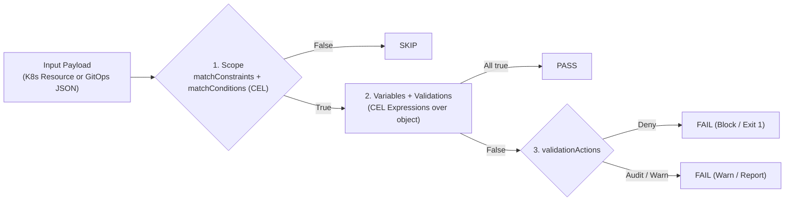

# Kyverno From First Principles: CEL `ValidatingPolicy` for Kubernetes & Non-Kubernetes GitOps JSON in Go

A hands-on engineering exploration of **Kyverno `v1.20.0`**—how its modern **CEL (`ValidatingPolicy`, `policies.kyverno.io/v1`)** engine evaluates Kubernetes workloads (`evaluation.mode: Kubernetes`), how a declarative `matchConditions` → `validations` CEL engine works from first principles, and how `evaluation.mode: JSON` (which superseded the archived `kyverno-json` sub-project) enables zero-regex GitOps policy guardrails over structured JSON state transitions.

---

## Mental Model: What Is Kyverno Really?

At its core, Kyverno is **not magic**—it is a **declarative scope-matching & CEL expression-evaluation engine** wrapped in a Kubernetes admission controller (and a standalone JSON evaluator).

When you run `kubectl apply -f deployment.yaml`, the Kubernetes API server sends an `AdmissionReview` JSON payload (containing the object being created/updated) to Kyverno's webhook before persisting it to `etcd`. Inside Kyverno's modern `ValidatingPolicy` (`policies.kyverno.io/v1`) engine, every policy boils down to three steps:

1. **Scope (`matchConstraints` / `matchConditions`)**: *Does this policy care about this payload?* In Kubernetes mode, `matchConstraints` filters by API group/version/resource/operation, and `matchConditions` runs CEL pre-filters. In `evaluation.mode: JSON`, `matchConstraints` is bypassed and `matchConditions` filters arbitrary JSON objects (e.g., `object.operation == 'update' && object.kind == 'PostgresDatabase'`). If a condition returns `false`, the policy is skipped (`SKIP`).
2. **Evaluate (`variables` + `validations` in CEL)**: *Compile and execute Common Expression Language (`object`, `variables`) against the payload.* Expressions can traverse nested objects safely with `has(...)` / optional chaining (`.?...`), iterate arrays with `.all(...)` / `.exists(...)`, and run RE2 `.matches(...)` checks.
3. **Decide (`Deny`, `Audit`, or `Warn`)**: Return `Pass`, `Fail`, or `Skip`. In Kubernetes, `Deny` rejects the API request; `Audit` lets it through and records a report violation.



> **Why `ValidatingPolicy` (`policies.kyverno.io/v1`) instead of `ClusterPolicy` and `kyverno-json`?**
> Starting with Kyverno `v1.19`–`v1.20`, legacy JMESPath-based `ClusterPolicy`/`Policy` (`kyverno.io/v1`) entered deprecation in favor of CEL-first policy types (`ValidatingPolicy`, `MutatingPolicy`, etc. under `policies.kyverno.io/v1`). Meanwhile, `kyverno/kyverno-json` (`json.kyverno.io/v1alpha1`) was archived in September 2026 and removed from core Kyverno (`kyverno json scan` was dropped in favor of `ValidatingPolicy` with `spec.evaluation.mode: JSON` and `kyverno apply --json`).

---

## Repository Layout

```text
kyverno-show/
├── LICENSE                                    # MIT License
├── README.md                                  # English guide
├── README.ru.md                               # Russian guide
├── part1-k8s/                                 # Part 1: Kubernetes ValidatingPolicy in Go + k3s guide
│   ├── go.mod / go.sum                        # Kyverno v1.20.0 + github.com/kyverno/api
│   ├── main.go                                # Embeds pkg/cel/policies/vpol/{compiler,engine}
│   ├── main_test.go                           # Verifies bad vs good Deployment manifests
│   ├── policies/
│   │   ├── require-pod-security.yaml          # Deny (2 policies): no :latest tag, runAsNonRoot, no privilege escalation
│   │   └── require-standard-labels.yaml       # Audit: require metadata.labels.team and env
│   └── manifests/
│       ├── deployment-bad.yaml                # Triggers 2 Deny failures + 1 Audit failure
│       └── deployment-good.yaml               # Passes all 3 policies
├── part2-gitops/                              # Part 2: From-first-principles GitOps diff validator in Go
│   ├── go.mod / go.sum                        # Kyverno v1.20.0 + google/cel-go
│   ├── main.go                                # CLI ('gitops-guard') supporting -engine kyverno & -engine mini
│   ├── main_test.go                           # Parity tests across both CEL engines
│   ├── policies/
│   │   └── gitops-diff-policy.yaml            # 4 ValidatingPolicy (evaluation.mode: JSON) docs for git diffs
│   ├── internal/
│   │   ├── diffparse/                         # Unified git diff -> structured DiffReport JSON adapter
│   │   └── firstprinciples/                   # ~155-line from-first-principles CEL evaluator over google/cel-go
│   └── samples/
│       ├── *.diff                             # Raw unified git diff fixtures
│       └── parsed/*.diff.json                 # Exact DiffReport JSON payloads evaluated by the engines
└── part3-json-gitops/                         # Part 3: Production-style JSON State-Transition GitOps PoC
    ├── go.mod / go.sum                        # Kyverno v1.20.0 + evaluation.mode: JSON
    ├── main.go                                # CLI comparing before/after JSON or git base vs working file
    ├── main_test.go                           # 13 tests covering Postgres, Kafka (+acls[]), AWS Secret & git
    ├── policies/
    │   ├── postgres-policy.yaml               # Create rules + update allowlist + no disk shrink + backup floor
    │   ├── kafka-policy.yaml                  # Update allowlist + no partition shrink + replication + acls[]
    │   └── aws-secret-policy.yaml             # No plaintext secretString + rotation bounds + immutable kmsKeyId
    ├── internal/jsondiff/                     # Recursive RFC 6902-style JSON diff -> ChangeEvent
    └── samples/
        ├── *.json                             # Before/after JSON resource states
        └── events/*.event.json                # Pre-built ChangeEvent JSON payloads (also usable with kyverno apply --json)
```

---

## Part 1: Kubernetes `ValidatingPolicy` (`part1-k8s`)

In Part 1, we use **real Kubernetes `ValidatingPolicy` (`policies.kyverno.io/v1`) manifests** and run them directly through Kyverno `v1.20.0`'s CEL `vpol` engine (`pkg/cel/policies/vpol`)—no cluster required—while keeping the exact YAML files ready to apply to **k3s on WSL** or check with `kyverno apply`.

### 1.1 Anatomy of the Policies

1. [require-pod-security.yaml](./part1-k8s/policies/require-pod-security.yaml) (`validationActions: [Deny]`, multi-document YAML with 2 policies):
   - **`disallow-latest-tag`**: Matches `apps/v1` `deployments` via `matchConstraints` and checks `object.spec.template.spec.containers.all(c, c.image.contains(':') && !c.image.endsWith(':latest'))`.
   - **`require-non-root`**: Uses CEL optional field access (`.?`) to verify `runAsNonRoot == true` on the pod template and `allowPrivilegeEscalation == false` on every container.
2. [require-standard-labels.yaml](./part1-k8s/policies/require-standard-labels.yaml) (`validationActions: [Audit]`):
   - **`require-standard-labels`**: Checks that `metadata.labels.team` and `metadata.labels.env` are both non-empty strings.

> **Why multi-document YAML instead of one policy with two `validations`?**
> In `ValidatingPolicy`, evaluation short-circuits on the first failing expression in `spec.validations[]` and returns a single rule outcome per policy. Splitting `disallow-latest-tag` and `require-non-root` into separate `ValidatingPolicy` resources ensures both violations are reported independently when `deployment-bad.yaml` fails both checks.

### 1.2 What Happens Inside the Go Code

In [part1-k8s/main.go](./part1-k8s/main.go):

1. **Load policies & manifests**: Multi-document YAML files are unmarshaled via `sigs.k8s.io/yaml` into `policiesv1beta1.ValidatingPolicy` structs (`v1` and `v1beta1` share `ValidatingPolicySpec`) and `unstructured.Unstructured` Kubernetes objects.
2. **Compile & initialize Kyverno's CEL `vpol` engine**:
   ```go
   provider, err := vpolengine.NewProvider(vpolcompiler.NewCompiler(), policies, nil)
   eng := vpolengine.NewEngine(provider, noopNsResolver, matching.NewMatcher())
   ```
3. **Simulate an Admission Request via `celengine.Request`**:
   ```go
   req := celengine.Request(nil, gvk, gvr, "", res.GetName(), res.GetNamespace(),
       admissionv1.Create, authenticationv1.UserInfo{}, &res, nil, false, nil)
   resp, err := eng.Handle(ctx, req, nil)
   ```
4. **Deny vs Audit handling**: Our CLI iterates `resp.Policies` and each policy's `Rules`, prints `[PASS]`/`[FAIL]`/`[SKIP]`, and only increments `enforcedFailures` (causing exit code `1`) when `polResp.Actions.Has(admissionregistrationv1.Deny)`.

> **Go Module Caveat (`replace` directives)**:
> `github.com/kyverno/kyverno v1.20.0` uses two `replace` directives in its own `go.mod` (for `github.com/kyverno/api` and `k8s.io/pod-security-admission`), which Go ignores for downstream consumers. That is why the `go.mod` files in this repo include the matching `replace` block.

### 1.3 Running Part 1 Locally (Go)

From `part1-k8s/`:

```bash
# Run unit tests
go test -v ./...

# Validate the non-compliant Deployment (exits with status 1)
go run . -policy ./policies -manifest ./manifests/deployment-bad.yaml

# Validate the compliant Deployment (exits with status 0)
go run . -policy ./policies -manifest ./manifests/deployment-good.yaml
```

Observed output on [deployment-bad.yaml](./part1-k8s/manifests/deployment-bad.yaml):

```text
[FAIL] policy=disallow-latest-tag action=Deny resource=Deployment/production/payments-api rule=validation
       message: Container images must use an explicit, immutable tag (':latest' or untagged images are forbidden).
[FAIL] policy=require-non-root action=Deny resource=Deployment/production/payments-api rule=validation
       message: Deployments must set pod securityContext.runAsNonRoot=true and disallow privilege escalation.
[FAIL] policy=require-standard-labels action=Audit resource=Deployment/production/payments-api rule=validation
       message: Deployments should define metadata.labels.team and metadata.labels.env for ownership tracking.

Summary: 3 policy evaluations, 2 enforced failures
```

### 1.4 Trying the Exact Same Policies with `kyverno` CLI or `k3s` in WSL

With the Kyverno CLI (`v1.20+`):

```bash
kyverno apply ./policies --resource ./manifests/deployment-bad.yaml
```

Or in a live `k3s` cluster via WSL:

```bash
# 1. Inside WSL (Ubuntu/Debian), install k3s (single-binary Kubernetes)
curl -sfL https://get.k3s.io | sh -
mkdir -p ~/.kube && sudo cp /etc/rancher/k3s/k3s.yaml ~/.kube/config && sudo chown $USER ~/.kube/config

# 2. Install Kyverno into the k3s cluster (via Helm)
helm repo add kyverno https://kyverno.github.io/kyverno/
helm repo update
helm install kyverno kyverno/kyverno -n kyverno --create-namespace --wait

# 3. Apply the ValidatingPolicies from this repo
cd part1-k8s
kubectl apply -f policies/

# 4. Test admission rejection vs acceptance
kubectl create namespace production
kubectl apply -f manifests/deployment-bad.yaml   # Blocked by admission webhook!
kubectl apply -f manifests/deployment-good.yaml  # Allowed (and passes Audit too)
```

---

## Part 2: From-First-Principles Custom GitOps Diff Validator (`part2-gitops`)

Kubernetes is just YAML/JSON objects flowing through a webhook. What if you want **Kyverno-style declarative policies** for something that is **not Kubernetes**—for example, validating a **raw `git diff` in a GitOps CI pipeline**?

In modern Kyverno, you no longer need the archived `kyverno-json` tool—`ValidatingPolicy` (`policies.kyverno.io/v1`) natively supports **`spec.evaluation.mode: JSON`**, allowing the exact same CEL engine to evaluate *any* JSON payload (Terraform plans, API payloads, CI metadata, or parsed diffs).

To understand it **from first principles**, Part 2 implements a 4-stage pipeline in Go (`gitops-guard`) with **two engines running the exact same `policies.kyverno.io/v1` `ValidatingPolicy` YAML**:
1. **`-engine kyverno`** (default): Calls Kyverno `v1.20.0`'s official CEL `vpol` engine in JSON mode (`celengine.RequestFromJSON(...)` with `nil` Kubernetes matcher).
2. **`-engine mini`**: A transparent ~155-line from-first-principles CEL evaluator ([internal/firstprinciples/engine.go](./part2-gitops/internal/firstprinciples/engine.go)) built directly over `github.com/google/cel-go` so you can trace every `[MATCH]`, `[VAR]`, `[CEL]`, and `[PASS]`/`[FAIL]` step yourself.

### 2.1 Stage 1: Turning a Raw `git diff` Into a Policy-Queryable Model

A declarative CEL engine cannot query raw unified diff text directly. So [internal/diffparse/parser.go](./part2-gitops/internal/diffparse/parser.go) parses a `git diff` plus CI/PR metadata (`author`, `branch`, `commitMessage`, `changeTicket`) into a structured `DiffReport` JSON object (saved examples live in [samples/parsed/](./part2-gitops/samples/parsed)):

```json
{
  "metadata": {
    "author": "dev-alice",
    "branch": "feature/payments-update",
    "changeTicket": "",
    "commitMessage": ""
  },
  "summary": {
    "totalFiles": 2,
    "totalAdded": 5,
    "totalRemoved": 2,
    "hasProdChanges": true,
    "environments": ["prod"]
  },
  "files": [
    {
      "path": "environments/prod/payments/deployment.yaml",
      "changeType": "modified",
      "environment": "prod",
      "addedLines": [
        "  replicas: 0",
        "          env:",
        "            - name: GITHUB_TOKEN",
        "              value: \"ghp_ExampleSecretToken987654\""
      ],
      "addedText": "  replicas: 0\n..."
    }
  ]
}
```

You can inspect or save this exact generated JSON at any time with `-dump-payload` or `-emit-json`.

### 2.2 Stage 2: Declarative `ValidatingPolicy` (`evaluation.mode: JSON`)

Look at [part2-gitops/policies/gitops-diff-policy.yaml](./part2-gitops/policies/gitops-diff-policy.yaml):

```yaml
apiVersion: policies.kyverno.io/v1
kind: ValidatingPolicy
metadata:
  name: require-ticket-for-prod
spec:
  validationActions:
    - Deny
  evaluation:
    mode: JSON
  matchConditions:
    - name: has-prod-changes
      expression: "has(object.summary) && object.summary.hasProdChanges == true"
  validations:
    - message: "Production GitOps changes require a valid changeTicket (CHG-#### or JIRA-####)."
      expression: >-
        has(object.metadata) &&
        has(object.metadata.changeTicket) &&
        object.metadata.changeTicket.matches('^(CHG|JIRA)-[0-9]+$')
---
apiVersion: policies.kyverno.io/v1
kind: ValidatingPolicy
metadata:
  name: forbid-zero-replicas-in-prod
spec:
  validationActions:
    - Deny
  evaluation:
    mode: JSON
  matchConditions:
    - name: has-prod-changes
      expression: "has(object.summary) && object.summary.hasProdChanges == true"
  validations:
    - message: "Scaling replicas to 0 in production manifests is forbidden."
      expression: >-
        has(object.files) &&
        object.files.all(f, !(f.environment == 'prod' && f.addedText.matches('(?m)^[[:space:]]*replicas:[[:space:]]*0([[:space:]]|$)')))
```

Notice the core CEL primitives replacing old JMESPath/tree-matching syntax:
- **Safe field presence (`has(object.summary)`)**: Guards against missing/omitted JSON fields before accessing nested keys.
- **Universal quantification (`object.files.all(f, ...)`)**: Replaces `~.files` foreach iteration with a typed CEL comprehension.
- **RE2 regex matching (`.matches(...)`)**: Standard CEL regex evaluation directly on strings.

### 2.3 Stage 3: Official Kyverno CEL vs From-First-Principles `mini` Engine

| Aspect | Kubernetes `ValidatingPolicy` (Part 1) | Kyverno JSON Mode (`-engine kyverno`) | From-First-Principles (`-engine mini`) |
| :--- | :--- | :--- | :--- |
| **Policy Model** | `ValidatingPolicy` (`policies.kyverno.io/v1`) | `ValidatingPolicy` (`evaluation.mode: JSON`) | Same `ValidatingPolicy` Go struct |
| **Input Payload** | `unstructured.Unstructured` K8s admission request | Any `map[string]any` / JSON (`RequestFromJSON`) | Any `map[string]any` / JSON (`object`) |
| **Core Algorithm** | `matchConstraints` → `matchConditions` → `validations` | `matchConditions` → `variables` → `validations` (CEL) | `cel-go` `Env` → `matchConditions` → `validations` |
| **Best For** | Live K8s admission & background scans | Production CI/CD & arbitrary JSON validation | Understanding how a CEL policy engine works inside |

Inside [part2-gitops/internal/firstprinciples/engine.go](./part2-gitops/internal/firstprinciples/engine.go), `NewEngine()` builds a `cel.Env` with `cel.Variable("object", cel.DynType)`, `cel.CrossTypeNumericComparisons(true)` (crucial because Go `encoding/json` decodes JSON numbers as `float64` while CEL literals like `0` are `int64`), `cel.OptionalTypes()`, and standard `cel-go` extensions (`Strings`, `Lists`, `Sets`, `Regex`).

### 2.4 Running Part 2 Locally (Go & CLI)

From `part2-gitops/`:

```bash
# Run all unit & cross-engine parity tests
go test -v ./...

# 1. Run official Kyverno CEL engine on a dangerous prod diff (exits 1, 4 failures)
go run . -diff ./samples/bad-prod-change.diff -engine kyverno

# 2. Run the from-first-principles mini engine with step-by-step trace
go run . -diff ./samples/bad-prod-change.diff -engine mini -trace

# 3. Inspect the JSON payload parsed from the raw diff
go run . -diff ./samples/good-prod-change.diff -message "release (CHG-4821)" -dump-payload

# 4. Staging-only diff: sets replicas: 0 in staging without a ticket -> PASSES (prod policies skipped)
go run . -diff ./samples/staging-only.diff -engine kyverno

# 5. (Optional) Validate parsed JSON directly with the official kyverno CLI
kyverno apply ./policies/gitops-diff-policy.yaml --json ./samples/parsed/bad-prod-change.diff.json
```

Observed output from `-engine mini -trace` on [bad-prod-change.diff](./part2-gitops/samples/bad-prod-change.diff) (excerpt):

```text
[FAIL] policy=forbid-hardcoded-secrets rule=validation
       -> Added diff lines must not contain hardcoded secrets, tokens, or passwords.
       trace: [MATCH] has-added-lines (has(object.summary) && object.summary.totalAdded > 0) -> true
       trace: [CEL] validation[0] (has(object.files) && object.files.all(f, f.addedLines.all(line,
  !line.matches('(?i)(ghp_[A-Za-z0-9]{8,}|AKIA[0-9A-Z]{8,}|(password|secret|api_key|token)[[:space:]]*[:=][[:space:]]*["\x27]?[A-Za-z0-9_\\-]{6,})')
))) -> false
       trace: [FAIL] Added diff lines must not contain hardcoded secrets, tokens, or passwords.

Engine=mini | Files=2 | ProdChanges=true | Failures=4
```

---

## Part 3: Leveling Up — Structured JSON Diff & State Transitions (`part3-json-gitops`)

Part 2 parsed a raw text `git diff` and ran regexes over added lines. That works as a universal fallback for arbitrary text, **but when your GitOps repository stores structured JSON (or YAML) resource definitions, regexes on diff text are the wrong abstraction**.

Why? Consider real infrastructure rules:
- *"When **creating** a production `PostgresDatabase`, require `storageGB >= 50`, `multiAZ: true`, and `backupRetentionDays >= 7`."*
- *"When **updating** an existing database, allow modifying **only** `storageGB`, `instanceClass`, `backupRetentionDays`, `maintenanceWindow`, or `metadata.labels/*`—and never allow shrinking `storageGB` (`after >= before`)!"*
- *"On a `KafkaTopic`, never decrease `partitions` or switch `cleanupPolicy`."*
- *"On a Terraform-managed `AwsSecretsManagerSecret`, forbid plaintext `secretString`, enforce rotation bounds (`1..90` days), and prevent changing `kmsKeyId` after creation."*

A line-based text diff doesn't know whether a number decreased (`200` → `100`), whether a file is being created vs updated, or the full JSON Pointer path of a changed attribute.

### 3.1 The Better Model: `before` + `after` + RFC 6902 `diff.changes[]`

Instead of regexes, [internal/jsondiff/diff.go](./part3-json-gitops/internal/jsondiff/diff.go) takes the previous JSON (`before`) and new JSON (`after`)—either from files or directly from `git show <base>:<file>` vs the working tree via `-git-base` + `-file`—and builds a typed `ChangeEvent` (pre-built examples in [samples/events/](./part3-json-gitops/samples/events)):

```json
{
  "operation": "update",
  "kind": "PostgresDatabase",
  "environment": "prod",
  "before": { "spec": { "storageGB": 200, "region": "eu-central-1", "backupRetentionDays": 14 } },
  "after":  { "spec": { "storageGB": 100, "region": "us-east-1",    "backupRetentionDays": 3  } },
  "diff": {
    "changedPaths": ["/spec/backupRetentionDays", "/spec/region", "/spec/storageGB"],
    "changes": [
      { "op": "replace", "path": "/spec/backupRetentionDays", "before": 14, "after": 3 },
      { "op": "replace", "path": "/spec/region", "before": "eu-central-1", "after": "us-east-1" },
      { "op": "replace", "path": "/spec/storageGB", "before": 200, "after": 100 }
    ]
  }
}
```

### 3.2 Zero-Regex Policies in CEL (`evaluation.mode: JSON`)

Look how expressive [postgres-policy.yaml](./part3-json-gitops/policies/postgres-policy.yaml), [kafka-policy.yaml](./part3-json-gitops/policies/kafka-policy.yaml), and [aws-secret-policy.yaml](./part3-json-gitops/policies/aws-secret-policy.yaml) are in modern CEL:

1. **Lifecycle-aware matching (`create` vs `update`)**:
   ```yaml
   matchConditions:
     - name: is-postgres-update
       expression: "object.operation == 'update' && object.kind == 'PostgresDatabase'"
   ```
2. **Allowlist of mutable attributes via JSON Pointer paths**:
   ```yaml
   validations:
     - message: "PostgresDatabase update may only modify storageGB, instanceClass, backupRetentionDays, maintenanceWindow, or metadata.labels/*."
       expression: >-
         !has(object.diff) ||
         !has(object.diff.changes) ||
         object.diff.changes == null ||
         object.diff.changes.all(c,
           c.path in ['/spec/storageGB', '/spec/instanceClass', '/spec/backupRetentionDays', '/spec/maintenanceWindow'] ||
           c.path.startsWith('/metadata/labels/')
         )
   ```
3. **Null-safe numerical invariants & array-of-objects checks**:
   ```cel
   // Compare after >= before safely even if a field was deleted
   has(object.after) &&
   has(object.after.spec) &&
   has(object.after.spec.storageGB) &&
   object.after.spec.storageGB != null &&
   has(object.before) &&
   has(object.before.spec) &&
   has(object.before.spec.storageGB) &&
   object.before.spec.storageGB != null &&
   object.after.spec.storageGB >= object.before.spec.storageGB

   // Validate every object inside KafkaTopic spec.acls[]
   object.after.spec.acls.all(a,
     has(a.principal) &&
     a.principal != null &&
     a.principal != 'User:*' &&
     has(a.operation) &&
     a.operation in ['READ', 'WRITE', 'DESCRIBE']
   )
   ```

### 3.3 Running Part 3 Locally (Go & CLI)

From `part3-json-gitops/`:

```bash
# Run all tests (Postgres, Kafka + acls[], AWS Secret, edge cases & git integration)
go test -v ./...

# Example 1: Illegal Postgres update (shrinks disk, changes region, drops backup retention)
go run . -before ./samples/postgres-update-before.json -after ./samples/postgres-update-bad.json

# Example 2: Safe Postgres update (grows disk 200 -> 500, upgrades instanceClass, updates label)
go run . -before ./samples/postgres-update-before.json -after ./samples/postgres-update-good.json

# Example 3: Evaluate a pre-built ChangeEvent JSON or emit CI-friendly JSON output
go run . -event ./samples/events/kafka-update-bad.event.json -output json

# Example 4: Compare a file directly against a base git ref in a real repo
go run . -git-base origin/main -file infra/prod/orders-db.json

# Example 5: (Optional) Validate the same ChangeEvent JSON via the official kyverno CLI
kyverno apply ./policies --json ./samples/events/postgres-update-bad.event.json
```

Observed output on the illegal Postgres update:

```text
Operation=update | Kind=PostgresDatabase | Env=prod | Changes=3
  [replace] /spec/backupRetentionDays: 14 -> 3
  [replace] /spec/region: eu-central-1 -> us-east-1
  [replace] /spec/storageGB: 200 -> 100
[FAIL] policy=postgres-update-allowed-attributes rule=validation id=orders-db
       PostgresDatabase update may only modify storageGB, instanceClass, backupRetentionDays, maintenanceWindow, or metadata.labels/*.
[FAIL] policy=postgres-no-disk-shrink rule=validation id=orders-db
       PostgresDatabase storageGB cannot be decreased or removed after creation (after >= before).
[FAIL] policy=postgres-prod-backup-floor rule=validation id=orders-db
       Production PostgresDatabase backupRetentionDays must remain >= 7.

Summary: Failures=3
```

---

## Key Takeaways

1. **Kyverno policies are data, not scripts**: By separating *what to check* (declarative `ValidatingPolicy` YAML) from *how to evaluate* (Kyverno's CEL engine), policy authors don't write imperative `if/else` Go code for every new rule.
2. **One unified policy model (`policies.kyverno.io/v1`) across K8s and JSON**: With `evaluation.mode: JSON`, the same `ValidatingPolicy` engine and `kyverno apply --json` workflow enforce guardrails on diffs, state transitions, Terraform plans, or custom CI events without relying on the archived `kyverno-json` tool.
3. **First-principles simplicity**: Stripped of Kubernetes webhook plumbing, caches, and metrics, a CEL policy engine is just an activation map (`object`, `variables`), boolean scope filters (`matchConditions`), and compiled CEL validation expressions.
